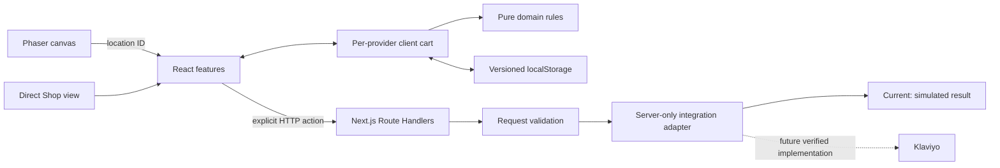

# SIDEQUEST architecture

Status: runnable project foundation. This document distinguishes the current scaffold from the intended full experience in [the PRD](SIDEQUEST-PRD.md).

## Stack and ownership

The application uses Next.js App Router, React, TypeScript, and Phaser. Next.js supplies the application server, routing, and build system. Vitest is the unit/integration test runner and Playwright checks browser journeys. Zod validates configuration and request bodies.

There is no Vite application or `vite.config` file. Vitest uses Vite as internal test infrastructure. Dependency versions are pinned in `package.json` and `package-lock.json`; TypeScript 6 and ESLint 9 satisfy the current Next.js lint plugin compatibility requirements. ESLint 9 is marked deprecated upstream; upgrade it when the bundled React/import/accessibility plugins accept ESLint 10. The project selects Node.js 24 through `.nvmrc`; the foundation was also checked on the available Node.js 26 runtime.



The subscription form exercises the API boundary. Product/cart/Oracle actions currently operate locally and do not automatically dispatch provider events. The API event contract prepares that later work.

## Directory structure

```text
src/
  app/
    layout.tsx                  Global HTML shell and metadata
    globals.css                 Starter responsive visual system
    (store)/
      layout.tsx                Persistent CartProvider and navigation
      page.tsx                  / — village
      shop/page.tsx             /shop — direct store
    api/
      identify/route.ts         Profile/preferences contract
      events/route.ts           Allowlisted event contract
      subscribe/route.ts        Explicit subscription contract
  features/
    world/                      React-to-Phaser host boundary
    shop/                       Product UI
    cart/                       Provider, store, persistence, bag UI
    checkout/                   Simulated order confirmation
    oracle/                     Starter recommendation interface
    support/                    FAQ fallback
    subscription/               Post Office form
  game/
    config.ts                   Browser engine factory
    art/                        Canvas-2D pixel-art painters
    scenes/                     Willow Market scene
    entities/                   Visitor sprite
    systems/                    Semantic interaction contract
    world/                      Tile map, location layout, hit areas
  domain/                       Catalog, cart, recommendation, order, event rules
  server/
    env.ts                      Server configuration validation
    http.ts                     Shared JSON request/response handling
    validation/                 Strict request schemas
    klaviyo/                    Server-only scaffold adapters
  components/ui/                Shared interface primitives
public/game/                    Future runtime textures, maps, audio
public/products/                Future product images
assets/source/                  Editable artwork, map projects, provenance
tests/integration/              Route and integration boundary tests
tests/e2e/                      Production browser journeys
skills/                         Versioned agent skills
```

Pure logic tests sit beside the code they exercise. Empty public asset directories are tracked with `.gitkeep`; the village artwork is procedural and lives in `src/game/art/`, so no raster source files exist yet.

## Module boundaries

`app/` composes features and adapts HTTP requests. It does not own game simulation or shopping calculations.

`domain/` contains data and pure logic without React, Phaser, server configuration, or network dependencies. Catalog prices are integer USD cents. Cart quantities are integers from 1 to 99; setting zero removes an item. Counts represent total units. The current catalog is explicitly fictional.

`features/` owns React interaction. Both routes share the cart through the common `(store)` layout. Each provider creates its own store; no mutable server singleton contains visitor state. Server and initial client snapshots are empty and consistent. Browser storage is read after mounting before writes are subscribed, and storage failure preserves an in-memory session. Only cart contents are persisted today; Oracle answers are currently local to the panel.

`game/` owns canvas objects. `WorldClient` loads `PhaserHost` through `next/dynamic` with server rendering disabled. Runtime Phaser imports stay behind that boundary. The host creates and destroys one game instance per mount and passes typed location and scene-readiness callbacks into the scene. The village artwork is painted once into a canvas texture and displayed at 2× with `pixelArt` filtering; interactive hit zones come from location data, not painted pixels. Game objects never own the cart or provider credentials. Movement and collision systems have not been implemented yet.

`server/` is marked with `server-only` imports. Route Handlers use Node.js and validate input before invoking adapters. Shared client/domain code does not import those modules. The Vitest configuration substitutes only the boundary marker during isolated Node tests; a real Next.js build still enforces the boundary.

## API contracts in this scaffold

All three endpoints accept JSON POST requests. Responses use `Cache-Control: no-store`. Request bodies are limited to 16 KiB, unknown fields are rejected, and supplied browser origins must use HTTP(S) and match the request's Host authority (host and port). This handles Next.js's internal URL normalization; forwarded-host headers are not trusted. This host check is not authentication, a full scheme-sensitive origin policy, or a complete abuse-control strategy.

| Endpoint | Input | Current result in demo mode |
| --- | --- | --- |
| `/api/identify` | `email`, optional `preferences` | A simulated identification result; no profile is created |
| `/api/events` | `email`, allowlisted `event`, UUID `eventId`, structured `properties` | A simulated event result; nothing is transmitted |
| `/api/subscribe` | `email`, `consent: true`, optional `preferences` | A simulated subscription result; no subscription or message |

The definitive schemas are in `src/server/validation/integrations.ts`. Preferences currently support companion, desk mood, and visual style. Event names are the four custom SIDEQUEST demo/discovery events, not real purchase metrics. Event-specific cross-field checks and actual dispatch/deduplication belong to the live integration implementation.

A successful demo result is HTTP 200 with `status: "simulated"`, `mode: "demo"`, `operation`, and `delivered: false`. Invalid input returns 400, forbidden origin 403, excessive body 413, and unsupported content type 415. An invalid mode or missing live configuration returns 503. Complete live configuration returns 501 because delivery adapters are not implemented. No endpoint silently claims live success.

## Environment configuration

`.env.example` is the tracked template. `.env.local` is the ignored local configuration file. Never put private keys into client-prefixed variables or commit real values. Next.js loads the local file; no extra dotenv runtime is needed.

| Variable | Visibility | Required now? | Purpose |
| --- | --- | --- | --- |
| `SIDEQUEST_MODE` | Server | Defaults to `demo` | Select explicit demo or future live integration behavior |
| `KLAVIYO_PRIVATE_API_KEY` | Server only | No in demo; validated in live | Future profile, event, and subscription requests |
| `KLAVIYO_LIST_ID` | Server only | No in demo; validated in live | Intended newsletter list |
| `KLAVIYO_API_REVISION` | Server only | No in demo; validated in live | Pinned provider contract; template uses `2026-10-15` |
| `NEXT_PUBLIC_KLAVIYO_SITE_ID` | Public | No | Reserved for a future supported onsite/chat loader; currently unused |

The revision was checked against Klaviyo's profile, event, and subscription documentation on 2026-11-02. A key for those planned operations needs the endpoint-required profile/event/list/subscription write scopes; consult the [integration brief](SIDEQUEST-Zone-Purposes-and-Klaviyo-Setup.md) and current provider docs before enabling delivery.

The browser has no independent demo/live toggle. Current UI labels all actions as demo; live mode cannot perform delivery in this scaffold. A public Site ID identifies an onsite integration and is not a substitute for a private key. `NEXT_PUBLIC_` values can be included in built browser bundles, so changing them may require rebuilding. Database, payment, and AI keys are deliberately absent because those services are not implemented or required for this foundation.

## Artwork and accessibility

Editable Aseprite/Tiled source belongs under `assets/source/`; exported textures/maps and product images belong under `public/`. Phaser loads ordinary URLs such as `/game/player.png`. Preserve atlas and tileset references when exporting. Base-path/CDN behavior must be checked if a future deployment introduces either.

The village scene is original code-drawn pixel art (`src/game/art/`) painted from a tested tile map; there are no raster source assets. Signpost labels over the map are aria-hidden DOM duplicates of the location navigation, which stays the accessible equivalent; the map container exposes a generated aria-label description of the destinations, and `prefers-reduced-motion` stops the label indicator. The visitor is a stationary sprite for now. `/shop` provides the direct route without loading the game scene. Commerce forms, feedback, and controls use HTML. The finished dialogue/modal and movement experience will require additional focus and keyboard arbitration checks.

## Persistence and hosting

The initial cart is stored only in the browser. Demo orders are local snapshots displayed after cart clearing. No account, durable order database, real checkout, or shipping operation exists.

Deploy this combined application on a host that supports the Next.js Node.js server runtime. Static export alone cannot execute its POST endpoints. For future persistent accounts/orders, introduce an appropriate database and migrations. For reliable asynchronous integration delivery, introduce a durable queue/outbox if needed; process memory and detached promises are not durable delivery systems.

## Verification and next implementation steps

Run type checks, lint, and Vitest before committing relevant changes. Playwright builds and starts the application in demo mode and covers desktop/mobile Chromium, real canvas hotspots and signpost labels for all four destinations, shared cart navigation/reload, demo checkout, and the simulated subscription response. These tests do not verify Klaviyo account behavior or final artwork fidelity.

The next product work is to add canvas hover/focus/selected states, implement movement/collision and dialogue, finish the Oracle flow and session preferences, and wire deliberate domain events to verified server adapters. Live account setup, identity rules, request abuse protection, retries/deduplication, and consent/confirmation evidence must precede external delivery. The supported chat widget needs its own account and loader setup.

## References

- [Next.js App Router backend](https://nextjs.org/docs/app/guides/backend-for-frontend)
- [Next.js environment variables](https://nextjs.org/docs/app/guides/environment-variables)
- [Next.js client-only loading](https://nextjs.org/docs/app/guides/lazy-loading)
- [Phaser with Next.js](https://github.com/phaserjs/template-nextjs)
- [Klaviyo profile API](https://developers.klaviyo.com/en/reference/create_or_update_profile)
- [Klaviyo event API](https://developers.klaviyo.com/en/reference/create_event)
- [Klaviyo subscription API](https://developers.klaviyo.com/en/reference/bulk_subscribe_profiles)
