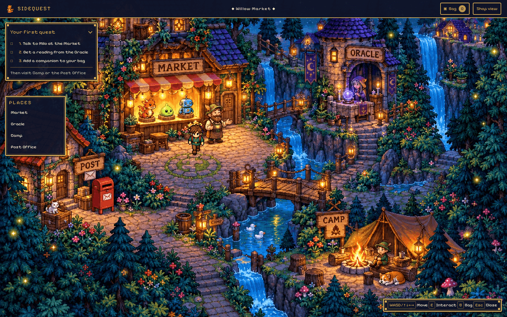
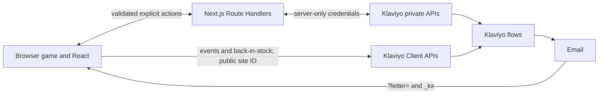

# SIDEQUEST

An explorable pixel-art storefront showcasing Klaviyo across the customer journey—from discovery and cart events to back-in-stock requests and personalized email letters.

[](https://github.com/RauPro/sidequest/actions/workflows/ci.yml) · [Play SIDEQUEST](https://sidequest.raul.engineer)



## Klaviyo touchpoints

| Zone | API / endpoint | Metric or properties | Code |
| --- | --- | --- | --- |
| Village and Market | Client `POST /client/events` | `Sidequest Location Visited {location}`, `Sidequest Product Viewed {productId, discoverySource}` | `src/features/game/GameShell.tsx`, `src/features/encounters/EncounterHost.tsx` |
| Shop and cart | Client `POST /client/events` | `Viewed Product`, `Added to Cart`, `Started Checkout` | `src/features/klaviyo/track.ts`, `src/domain/klaviyoMetrics.ts` |
| Oracle | `POST /api/oracle/preferences`; Client events | `Sidequest Oracle Completed {recommendedProductId, ruleVersion, deskMood, visualStyle}` | `src/features/oracle/`, `src/app/api/oracle/preferences/` |
| Camp | `POST /api/camp/chat`; Client event | `Sidequest Camp Question Asked {topic}`; raw chat text is not an event property | `src/features/encounters/EncounterHost.tsx`, `src/app/api/camp/chat/` |
| Post Office | `POST /api/subscribe`; Client event | Explicit newsletter consent; `Sidequest Letter Opened {letter}` | `src/features/subscription/`, `src/domain/letters.ts` |
| Back in stock | Client `POST /client/back-in-stock-subscriptions` | Email channel and feed-derived catalog variant ID | `src/features/klaviyo/backInStock.ts`, `src/domain/inventory.ts` |
| Catalog | `GET /catalog/klaviyo.json` | Public product, availability, `inventory_quantity`, `inventory_policy` fields | `src/domain/catalog-feed.ts` |

## Architecture



## Design decisions & trade-offs

- **Demo/live separation:** demo mode is the default and makes no provider request. Client calls require `NEXT_PUBLIC_SIDEQUEST_CLIENT_TRACKING=live` and a valid public site ID; server routes have their own gates.
- **Truthful states:** HTTP 202 is request acceptance, not a confirmed subscription, visible event, or delivered email. The back-in-stock UI preserves this distinction.
- **Stable events:** retries reuse the same `unique_id` and encoded payload. Demo checkout has a custom demo metric and never sends `Placed Order` or real revenue fields.
- **Consent and abuse controls:** newsletter signup is explicit and double opt-in; public server routes use BotID and rate limits where configured.
- **Client/server split:** browser-safe Client APIs handle behavioral metrics and explicit back-in-stock requests. Private profile, newsletter, Oracle, and Camp operations stay behind server routes. The private API key is never public.
- **Identity trade-off:** remembered email, `anonymous_id`, and email-link `_kx` support profile attribution. Client identifiers are untrusted and are not authentication or authorization.
- **Commerce scope:** cart and checkout are fictional demos; there are no payments, fulfillment, or real orders.

## Run locally

```sh
source ~/.nvm/nvm.sh && nvm use
npm ci
cp .env.example .env.local
npm run dev
```

Open `http://localhost:3000`. The playable village is `/`; `/shop` and `/products/ember` provide direct store paths. Local configuration defaults to demo mode.

## Checks

```sh
npm run typecheck
npm run lint
npm test
npm run build
npm run test:e2e
```

See [Architecture](docs/ARCHITECTURE.md), [Klaviyo integration](docs/KLAVIYO-INTEGRATION.md), the [account runbook](docs/KLAVIYO-ACCOUNT-RUNBOOK.md), [product pages and catalog](docs/PRODUCT-PAGES.md), [Customer Agent contract](docs/CUSTOMER-AGENT.md), [PRD](docs/SIDEQUEST-PRD.md), and [zone and integration brief](docs/SIDEQUEST-Zone-Purposes-and-Klaviyo-Setup.md).
