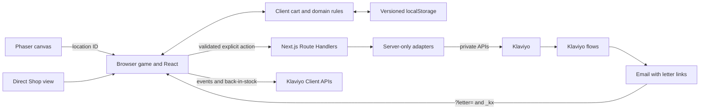

# SIDEQUEST architecture

Status: implemented showcase. The runnable experience includes the village, shared cart, public Klaviyo catalog, guarded server operations, Client API tracking, back-in-stock requests, and personalized letter deep links. Product intent is in [the PRD](SIDEQUEST-PRD.md).

## Stack and ownership

The application uses Next.js App Router, React, TypeScript, and Phaser. Next.js supplies the application server, routing, and build system. Vitest is the unit/integration test runner and Playwright checks browser journeys. Zod validates configuration and request bodies.

There is no Vite application or `vite.config` file. Vitest uses Vite as internal test infrastructure. Dependency versions are pinned in `package.json` and `package-lock.json`; TypeScript 6 and ESLint 9 satisfy the current Next.js lint plugin compatibility requirements. ESLint 9 is marked deprecated upstream; upgrade it when the bundled React/import/accessibility plugins accept ESLint 10. The project selects Node.js 24 through `.nvmrc`; the foundation was also checked on the available Node.js 26 runtime.



Demo mode keeps the experience usable without Klaviyo requests. Intentional product views, cart changes, checkout starts, and letter opens go through the Client API integration (simulated in demo and sent only when live); demo checkout never emits a real order metric. Back-in-stock requests use the public Client API only after explicit form submission. Profile, newsletter, Oracle preference, and Camp operations use their guarded server routes. Anonymous IDs and `_kx` support attribution, but neither is authentication.

## Directory structure

```text
src/
  app/
    layout.tsx                  Global HTML shell and metadata
    globals.css                 Starter responsive visual system
    (store)/
      layout.tsx                Persistent CartProvider
      page.tsx                  / — village
      shop/layout.tsx           Direct-store navigation and page shell
      shop/page.tsx             /shop — direct store
      products/layout.tsx       Product navigation and page shell
      products/[slug]/page.tsx   Companion product pages
    catalog/klaviyo.json/        Public catalog feed
    api/
      identify/route.ts         Profile/preferences contract
      events/route.ts           Allowlisted event contract
      subscribe/route.ts        Explicit subscription contract
      oracle/preferences/       Gated Oracle profile save
  features/
    game/                       Full-screen HUD and location panels
    world/                      React-to-Phaser host boundary
    shop/                       Product UI
    cart/                       Provider, store, persistence, bag UI
    oracle/                     Starter recommendation interface
    subscription/               Post Office form
    encounters/                 Market, Oracle, Camp, Post Office, and bag
    klaviyo/                    Client API, identity, and Raven Ledger
    products/                   Product page and purchase controls
  game/
    config.ts                   Browser engine factory
    art/                        Canvas-2D pixel-art painters
    scenes/                     Willow Market scene
    entities/                   Animated visitor and movement
    systems/                    Bridge, camera, collision, pathfinding
    world/                      Tile map, location layout, hit areas
  domain/                       Catalog, cart, recommendation, order, event rules
  server/
    env.ts                      Server configuration validation
    http.ts                     Shared JSON request/response handling
    validation/                 Strict request schemas
    klaviyo/                    Server-only profile, event, subscription adapters
  components/ui/                Shared interface primitives
public/game/                    Future runtime textures, maps, audio
public/images/products/         Generated public companion PNGs
assets/source/                  Editable artwork, map projects, provenance
tests/integration/              Route and integration boundary tests
tests/e2e/                      Production browser journeys
skills/                         Versioned agent skills
```

Pure logic tests sit beside the code they exercise. Empty public asset directories are tracked with `.gitkeep`; the current village artwork is procedural and lives in `src/game/art/`. Raster scenery and sprite assets may be added as the village moves closer to `../ui-concepts/sidequest.png`.

## Module boundaries

`app/` composes features and adapts HTTP requests. It does not own game simulation or shopping calculations.

`domain/` contains data and pure logic without React, Phaser, server configuration, or network dependencies. Catalog prices are integer USD cents. Cart quantities are integers from 1 to 99; setting zero removes an item. Counts represent total units. The current catalog is explicitly fictional.

`features/` owns React interaction. Village, shop, and product routes share the cart through the common `(store)` layout. Each provider creates its own store; no mutable server singleton contains visitor state. Server and initial client snapshots are empty and consistent. Browser storage is read after mounting before writes are subscribed, and storage failure preserves an in-memory session. Cart contents and the selected Oracle mood are stored locally. An explicit Oracle form submission can save derived preferences to an allowlisted profile without adding marketing consent.

`game/` owns canvas objects. `GameShell` loads `PhaserHost` through `next/dynamic` with server rendering disabled. Runtime Phaser imports stay behind that boundary. React and the scene talk through `createGameBridge()` (`systems/bridge.ts`): events `ready`/`open`/`nearby`/`hover`/`player-tile` go up, commands `input`/`highlight` go down; neither side owns the other's state and engine interactions never own or mutate the cart. The village artwork is painted once into canvas textures by `art/manifest.ts`: a ground layer, y-sorted building/prop/NPC sprites, a foreground canopy layer, additive light glows, and a vignette, all with `pixelArt` filtering. Pure systems drive gameplay: `systems/camera.ts` (zoom/center math shared with e2e), `systems/movement.ts` (foot-box collision and wall sliding), `systems/pathfinding.ts` (A* tap-to-move), and `world/decor.ts` (decor data shared by art and collision). Location hit zones emit `open`; the keyboard owns movement only while the stage has focus and input is enabled.

`server/` is marked with `server-only` imports. Route Handlers use Node.js and validate input before invoking adapters. Shared client/domain code does not import those modules. The Vitest configuration substitutes only the boundary marker during isolated Node tests; a real Next.js build still enforces the boundary.

## API contracts

Server Route Handlers accept validated JSON POST requests, return `Cache-Control: no-store`, enforce route-specific limits, and apply BotID where required. Request bodies are bounded and strict schemas reject unsupported fields. These origin and bot checks are abuse controls, not user authentication.

| Endpoint | Input | Current result in demo mode |
| --- | --- | --- |
| `/api/identify` | `email`, optional `preferences` | A simulated identification result; no profile is created |
| `/api/events` | `email`, allowlisted `event`, UUID `eventId`, structured `properties` | A simulated event result; nothing is transmitted |
| `/api/subscribe` | `email`, `consent: true`, optional `preferences` | A simulated subscription result; no subscription or message |
| `/api/oracle/preferences` | `email`, supported `mood` | `status: simulated`, `saved: false`; no provider call |
| `/api/camp/chat` | Structured Camp conversation | Simulated or guarded server response |

The browser also calls Klaviyo's Client API directly for custom and standard events and for explicitly requested back-in-stock subscriptions. The client requires a public site ID and `NEXT_PUBLIC_SIDEQUEST_CLIENT_TRACKING=live`; demo is the default. No private API key is shipped to the browser. `GET /catalog/klaviyo.json` exposes stable product IDs, prices, URLs, availability, and inventory fields without credentials.

The definitive server schemas are in `src/server/validation/integrations.ts`. Client events include `Viewed Product`, `Added to Cart`, `Started Checkout`, and custom discovery/letter metrics. A retry reuses its logical `unique_id`; simulated orders do not emit `Placed Order` or revenue fields.

A successful demo result is HTTP 200 with `status: "simulated"`, `mode: "demo"`, `operation`, and `delivered: false`. Invalid input returns 400, forbidden origin 403, excessive body 413, and unsupported content type 415. An invalid mode or missing live configuration returns 503. A recipient outside the configured development allowlist returns 403. Live profile updates return an identified profile ID; event and subscription requests return HTTP 202 with accepted/pending status. Provider failures are mapped to redacted error codes. See `KLAVIYO-INTEGRATION.md` for retry semantics.

## Environment configuration

`.env.example` is the tracked template. `.env.local` is the ignored local configuration file. Never put private keys into client-prefixed variables or commit real values. Next.js loads the local file; no extra dotenv runtime is needed.

| Variable | Visibility | Required now? | Purpose |
| --- | --- | --- | --- |
| `SIDEQUEST_MODE` | Server | Defaults to `demo` | Select demo or live profile/event/subscription behavior |
| `KLAVIYO_SUBSCRIPTION_ACCESS` | Server | Defaults to `invited` | `public` opens only BotID-protected, double-opt-in newsletter signup on Vercel |
| `ORACLE_PROFILE_MODE` | Server | Defaults to `demo` | Independently select demo or live Oracle preference saves |
| `ORACLE_PROFILE_ALLOWED_EMAILS` | Server only | Required for live Oracle saves | Invited tester emails; empty blocks profile saves |
| `KLAVIYO_PRIVATE_API_KEY` | Server only | No in demo; validated in live | Profile, event, subscription, and Oracle requests |
| `KLAVIYO_LIST_ID` | Server only | No in demo; validated in live | Intended newsletter list |
| `KLAVIYO_API_REVISION` | Server only | No in demo; validated in live | Pinned provider contract; template uses `2026-10-15` |
| `KLAVIYO_LIVE_ALLOWED_EMAILS` | Server only | Required for invited live operations | Comma-separated test recipients; empty blocks identify/events and invited subscriptions |
| `NEXT_PUBLIC_KLAVIYO_SITE_ID` | Public | Required for live Client API calls | Public site/company ID for browser events and back-in-stock; not a private key |
| `NEXT_PUBLIC_SIDEQUEST_CLIENT_TRACKING` | Public | Defaults to `demo` | `demo` simulates Client API activity; `live` enables requests when the site ID is valid |
| `NEXT_PUBLIC_SIDEQUEST_SOLD_OUT` | Public | Defaults to empty | Comma-separated sold-out product IDs, for example `bolt` |

The server-side Klaviyo adapters use the pinned `2026-10-15` revision and require the endpoint-specific scopes listed in [Klaviyo integration](KLAVIYO-INTEGRATION.md). Provider delivery still depends on the configured account, environment, and consent gates.

Server routes and browser Client API calls have separate demo/live controls. The newsletter form reads only the public mode from `GET /api/subscribe` and distinguishes simulation from acceptance. Accepted subscription jobs are not presented as confirmed subscription or email delivery. The public Site ID is used by browser Client API calls and is not a private key. `NEXT_PUBLIC_` values can be included in built browser bundles, so changing them may require rebuilding. Database, payment, and AI keys are deliberately absent because those services are not implemented or required.

## Artwork and accessibility

Editable Aseprite/Tiled source belongs under `assets/source/`; exported textures/maps and product images belong under `public/`. Phaser loads ordinary URLs such as `/game/player.png`. Preserve atlas and tileset references when exporting. Base-path/CDN behavior must be checked if a future deployment introduces either.

The village scene is currently code-drawn pixel art (`src/game/art/`) painted from a tested 40×25 tile map with 16-pixel tiles; [the concept image](../ui-concepts/sidequest.png) is its visual target, and the map size, tile size, and art pipeline may change to match it. Destination names are painted signboards in the artwork, while the location navigation stays the accessible equivalent; the stage exposes a generated aria-label description of the destinations. The visitor walks with arrow keys/WASD or tap-to-move, collides with tiles/decor, and enters nearby places with E/Space/Enter. React panels disable game input while forms are open and return focus when closed. `/shop` provides the direct route without loading the game scene. Commerce forms, feedback, and controls use HTML.

## Persistence and hosting

The initial cart is stored only in the browser. Demo orders are local snapshots displayed after cart clearing. No account, durable order database, real checkout, or shipping operation exists.

Deploy this combined application on a host that supports the Next.js Node.js server runtime. Static export alone cannot execute its POST endpoints. For future persistent accounts/orders, introduce an appropriate database and migrations. For reliable asynchronous integration delivery, introduce a durable queue/outbox if needed; process memory and detached promises are not durable delivery systems.

## Verification and remaining boundaries

Vitest and Playwright cover domain rules, route validation, mocked provider behavior, desktop/mobile journeys, canvas hotspots, keyboard/tap movement, form input isolation, shared cart navigation/reload, product pages, catalog feed, Oracle saves, and subscription responses. Automated checks do not verify live Klaviyo account behavior or email delivery.

The showcase includes Oracle recommendations, environmental art, shopping-event dispatch, personalized letter links, and in-game Camp assistance. Klaviyo account-side flow setup and review remain separate from code delivery; use the [account runbook](KLAVIYO-ACCOUNT-RUNBOOK.md). Anonymous IDs and `_kx` provide attribution, not authentication. The Camp encounter uses an application Route Handler; no Klaviyo web-chat widget is loaded.

## References

- [Next.js App Router backend](https://nextjs.org/docs/app/guides/backend-for-frontend)
- [Next.js environment variables](https://nextjs.org/docs/app/guides/environment-variables)
- [Next.js client-only loading](https://nextjs.org/docs/app/guides/lazy-loading)
- [Phaser with Next.js](https://github.com/phaserjs/template-nextjs)
- [Klaviyo profile API](https://developers.klaviyo.com/en/reference/create_or_update_profile)
- [Klaviyo event API](https://developers.klaviyo.com/en/reference/create_event)
- [Klaviyo subscription API](https://developers.klaviyo.com/en/reference/bulk_subscribe_profiles)
